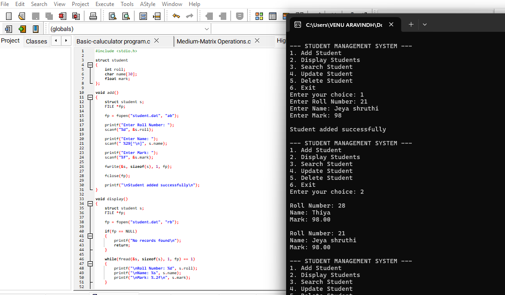

# Student Management System in C

This project is developed using C Language and File Handling.

Features:

1. Add Student
2. Display Students
3. Search Student
4. Update Student
5. Delete Student
6. Exit

Sample Output:

--- STUDENT MANAGEMENT SYSTEM ---

1. Add Student
2. Display Students
3. Search Student
4. Update Student
5. Delete Student
6. Exit

Enter your choice: 1

Enter Roll Number: 21
Enter Name: Jeya Shruthi
Enter Mark: 98

Student added successfully

Enter your choice: 2

Roll Number: 21
Name: Jeya Shruthi
Mark: 98.00

## Output Screenshot

